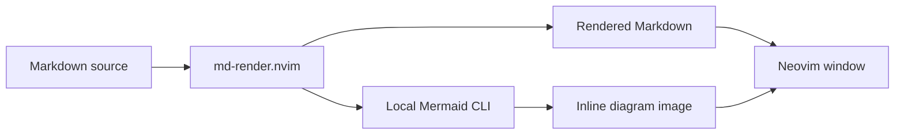

# Markdown preview

Open this file in Neovim and press `<leader>mt` to switch between the raw source
and the rendered document in the current window. Press `<leader>ms` for a
vertical split with both views. Source edits update the preview live.

| Key          | Action                                       |
|--------------|----------------------------------------------|
| `<leader>mt` | Toggle source / render in the current window |
| `<leader>ms` | Open a vertical source / render split        |
| `<leader>mp` | Toggle floating preview                      |
| `<leader>md` | Open the upstream demo                       |

## Mermaid example

**Bold**, *italic*, `inline code`, lists, tables, and diagrams appear together
in the rendered view. This document also works as a manual smoke check.

## Navigation and editing

The render buffer is read-only. Toggle back to the source to edit, or edit in
the source side of the split. `<C-h>` / `<C-l>` move between windows;
`<C-w>c` closes the focused split. Cursor and scroll positions synchronize
between source and render. Use `za` or `<CR>` to expand supported regions.
Ordinary `h/j/k/l` keep their usual directions.

Keep one rendered window per source when viewing diagrams: upstream can bind
inline images to only one window at a time. Additional render windows still
update their text, but the latest render window owns the images.

## Requirements and local choices

Neovim 0.12+ and a Kitty graphics compatible terminal are required for the full
preview. Mermaid renders locally with `mmdc` from `@mermaid-js/mermaid-cli`;
see [prerequisites](prerequisites.md#markdown-and-mermaid-preview).
The first uncached diagram can take longer while headless Chrome starts.
On Linux, system `google-chrome` is selected when available and
`PUPPETEER_EXECUTABLE_PATH` is unset, to use its working browser sandbox.

Experimental scaled headings are disabled. Automatic source/render switching
on insert mode is left off; source/render transitions stay explicit.
Obsidian continues to own its source-buffer UI and vault navigation.

Diagram placements are hidden while entering commands or searches and restored
afterward, so terminal images cannot cover the Noice command palette. This is
a local workaround for terminal image layering. A second guard repaints images
when synchronized split scrolling reports the source window first: upstream
otherwise misses the preview's scroll and leaves diagram images frozen over
moving text. Off-screen diagrams are cleared; visible ones are placed again.
